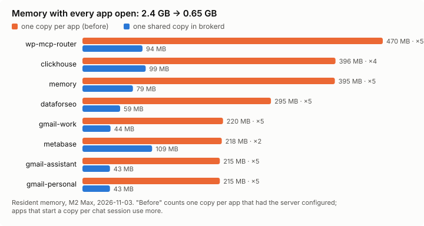

# brokerd — one MCP hub for every AI app and agent on your machine

Every AI app you use (Claude Code, Codex, Cursor, OpenCode, Claude Desktop) starts its own copy of each MCP server,
keeps its own copy of each API key, and makes you sign in to each remote server separately. Agents you run
headless get the same keys you do.

**brokerd runs each MCP server once and hands it to every app and agent**, without them noticing the difference:

- **Invisible to your apps.** Each app keeps one entry per server under the name it already knew. Tools, results,
  errors, instructions, prompts and resources pass through exactly as the server sends them, so your permission
  rules and approval settings keep working.
- **One place for servers and secrets.** `~/.brokerd/connectors.yaml` and `secrets.json`, hot-reloaded. Add a server
  once; every app sees it, mid-chat. `brokerd client adopt` moves the servers your apps already have, with a
  one-command restore.
- **Sign in once.** Remote servers with OAuth (`brokerd auth vercel`) are signed in by the broker, refreshed by the
  broker, and shared by every app.
- **Agents get grants, not keys.** A headless agent gets a token scoped to the servers, queries, sites and operations
  in its config, minted per run and revoked when it ends, with a receipt for every call. Owner-only servers
  (your Gmail) can never be granted.
- **Less context.** `expose: broker` keeps a server out of the preloaded tool list; the model finds and runs its tools
  through `search_tools` / `call_tool` when needed. Low-effort Haiku and GPT-6 Luna both used them 3/3.
- **Shape what comes through.** Per server: which apps get it, tool include/exclude globs, strip schema parts,
  trim or filter responses (including through your own command, e.g. `jq`).



| Measured | |
|---|---|
| Memory, 8 local servers, every app open | 2,424 MB → 645 MB |
| Latency added per tool call | ≈ 0.6 ms |
| Tool definitions loaded per chat, 304 tools | 1.05 MB → 1.6 KB on demand |

Methods and caveats in [docs/benchmarks.md](docs/benchmarks.md). macOS today (launchd); the daemon is plain Go.

## Install

```sh
git clone https://github.com/danieliser/capability-broker ~/Toolkit/capability-broker
cd ~/Toolkit/capability-broker
./install.sh            # builds with a stamped identity, installs ~/.local/bin/brokerd, loads launchd
brokerd status
```

Keys live in `~/.brokerd/secrets.json` (0600) and are referenced as `${secret:NAME}`; the installer seeds
`~/.brokerd/connectors.yaml` from `connectors.example.yaml`. Settings: `BROKERD_PORT`, `BROKERD_HOST` (loopback
only), `BROKERD_DATA_DIR`.

## Move your existing servers in

```sh
brokerd client adopt dataforseo metabase gmail-work --dry-run   # see the connector definitions first
brokerd client adopt dataforseo metabase
brokerd client adopt gmail-work --owner-only                    # never granted to agents
brokerd client install all                                      # every app: one entry per server, original names
brokerd auth vercel                                              # OAuth servers: sign the broker in once
brokerd client restore metabase                                  # changed your mind: put it back everywhere
```

`adopt` reads the server from whichever app has it, moves its keys into `secrets.json`, turns `mcp-remote` wrappers
into native remote connectors, and leaves a restorable copy in every app's config. It warns when an app has
permission rules keyed to that server.

## Configure a server

```yaml
connectors:
  dataforseo:
    command: npx                       # npx/uvx runners are pinned to one installed version
    args: [-y, dataforseo-mcp-server]
    env: { DATAFORSEO_PASSWORD: "${secret:DATAFORSEO_PASSWORD}" }
  vercel:
    url: https://mcp.vercel.com/
    oauth: {}                          # discovery + dynamic registration; brokerd auth vercel
  metabase:
    command: uv
    args: [--directory, ~/mcp/metabase, run, server.py]
    expose: broker                     # not preloaded; found through search_tools / call_tool
    clients: [claude-code, codex]      # or [!cursor]
    tools: { exclude: ["delete_*"] }   # hidden and refused for every caller
    response: { drop_keys: [debug], max_chars: 20000 }
  gmail-work:
    command: gog
    args: [--account, work, --readonly, mcp]
    owner_only: true
```

Every option, with the rest of the behaviour, is in [docs/reference.md](docs/reference.md).

## Agents

A control plane (PERSIST, here) mints a grant per agent run over the admin socket:

```json
{
  "clickhouse": { "queries": ["scheduler.freshness"], "limits": { "max_rows": 2000 } },
  "wp-mcp-router": { "sites": ["wppopupmaker"], "operations": ["content.read", "content.draft"] },
  "memory": { "namespaces": ["agent:my.agent"], "operations": ["recall", "store"] }
}
```

The agent sees one `broker` server with only those tools, arguments narrowed to what it may use, responses trimmed
for its context, and a receipt row before and after every call. The grant dies with the session.

## Commands

```sh
brokerd status                                # every connector: ok | needs sign-in | degraded (why)
brokerd auth [<connector>|<prefix>]           # OAuth sign-in; bare `brokerd auth` lists what is waiting
brokerd client install <app>|all [--mode servers|single] [--revert]
brokerd client adopt <server>[=<connector>]... [--owner-only] [--dry-run]
brokerd client restore <server>...
brokerd reload                                # apply connectors.yaml / secrets.json now instead of within 2s
brokerd queries push --project <key> --file queries.yaml   # named ClickHouse queries agents may run
brokerd grant mint|list|revoke                # agent grants (a control plane normally does this)
brokerd receipts --limit 50                   # what ran, for whom, with what outcome
brokerd-probe -raw -url http://127.0.0.1:8890/mcp/<connector> -token "$TOKEN" [-tool <t> -args '{...}']
```

`client install` modes: `servers` (default) gives each app one entry per server under its original name plus a
`broker` entry that carries servers added mid-chat and on-demand servers; `single` gives one `broker` entry with
every tool (what agents use; measured equal for low-effort models in [docs/eval.md](docs/eval.md)). Installed apps
are managed: when a server is added or removed, the daemon updates their configs.

## Layout

```
cmd/brokerd             daemon + CLI (auth, client adopt/install/restore, grants, receipts)
cmd/brokerd-probe       shell MCP client
cmd/mockmcp             test server exercising every MCP feature the broker passes through
pkg/adapters/upstream   hosts stdio and remote servers: discovery, hooks, response filters, relay
pkg/mcpfront            the MCP endpoints apps and agents connect to; on-demand discovery
pkg/remoteauth          OAuth sign-in and token refresh for remote servers
pkg/auth  pkg/policy    grants, capabilities, the single authorization point
pkg/catalog             operations per connector (embedded, overlay, synthesized)
pkg/connectors          connectors.yaml
pkg/reload  pkg/pins    hot reload; pinned npx/uvx installs
pkg/audit  pkg/durable  receipts, SQLite
test/e2e                the broker against cmd/mockmcp
bench/                  memory and context benchmarks
skills/                 an agent skill for operating brokerd
```

## Development

```sh
go test ./...
go test -race ./pkg/mcpfront ./pkg/auth
go vet ./... && gofmt -l .
go test ./test/e2e -run '^$' -bench . -benchtime 2000x   # latency, direct vs through the broker
python3 bench/memory_bench.py --copies <server>=<apps> ... # memory, one copy per app vs shared
python3 bench/context_bench.py                             # context tokens per chat, Claude Code and Codex
```

Releases: open a `release/X.Y.Z` branch whose `CHANGELOG.md` top entry is `## [X.Y.Z] - date`, raise a PR into
`main`; the gate checks branch, changelog and build identity; merging publishes the tag and a GitHub release built
from the merge commit.

## Boundaries

Same-UID processes that are not sandboxed can read `~/.brokerd`; the broker protects credentials from agents that
run inside Claude Code's OS sandbox or a container, not from an unrestricted owner shell. It does not claim
resistance to owner or root compromise.

## License

MIT
