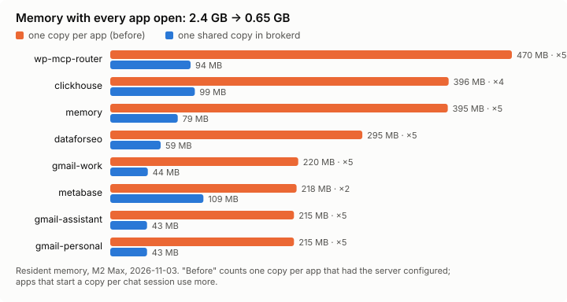

# Benchmarks

Measured 2026-11-03 on an Apple M2 Max (macOS) with brokerd 0.9.0 (memory, context) and 0.11.0 (latency,
broker memory, tool definitions), with 14 connectors: 8 local stdio servers
(ClickHouse, AutoMem, three Gmail accounts, Metabase, a WordPress router, DataForSEO) and 6 remote ones (Vercel,
Stack Overflow for Agents, OpenAI docs, Cloudflare ×2, Cloudways). Resident memory moves with what else the
machine is doing (macOS compresses idle pages), so treat memory figures as ±20%. Every number has a script in
`bench/` or `test/e2e/`.

## Memory: one copy of each server instead of one per app

| | Memory |
|---|---|
| One copy per app (Claude Code, Codex, Cursor, OpenCode, Claude Desktop, as configured) | **2,424 MB** |
| brokerd: one shared copy of each server | **570 MB** + 75 MB for the broker |

Method: resident memory (`ps rss`) of each child process brokerd runs, including grandchildren (a `uv` launcher
and its Python, for example), multiplied by the number of apps that had that server configured before it moved
into the broker (`~/.brokerd/clients/adopted.json`). This is a floor: Claude Code starts its servers per chat
session, so several open chats multiply the "before" column again. Reproduce with
`python3 bench/memory_bench.py --copies clickhouse=4 memory=5 wp-mcp-router=5`.

With `on_demand: true` on the four least-used servers (Metabase, DataForSEO, two Gmail accounts), the broker
starts only the other four at boot: about 314 MB of servers instead of 570 MB. A call to a stopped server starts it
(0.3 s for a pinned Node server, 2.3 s for a Python server run through `uv`) and `idle_stop` stops it again.

## Latency added per tool call

| Path (brokerd 0.11.0) | Per call, median of 5 runs |
|---|---|
| Client → stdio server directly | 0.19 ms |
| Client → brokerd (Streamable HTTP, grant check, receipts) → same stdio server | 0.54 ms |
| **Added by the broker** | **≈ 0.35 ms** |

Method: `go test ./test/e2e -run '^$' -bench . -benchtime 2000x -count 5` calls the mock server's `echo` tool
2,000 times per run. The machine was not idle (load average ~4.9 from other work), so single runs ranged 0.15–0.36
ms direct and 0.45–0.63 ms through the broker. Since 0.10.1 the after-call receipt is written in batches off the
call path (0.9.0 measured 0.70 ms through the broker on a quieter machine). Network-bound upstreams take tens to
hundreds of milliseconds per call, so the broker's share is noise there.

## The broker itself

0.11.0 after 15 minutes with 14 connectors and 312 tools: **about 70 MB resident, 27 MB of live heap**, half of
it upstream tool schemas (Vercel's 241 tools are most of that). The rest is the Go runtime and the program
(`GOMEMLIMIT` 48 MiB and `GOGC` 50 by default; set either in the environment to override). A Rust port of the
core (kept on the `exp/rust-port-full` branch, not at parity) ran the same mock server in 15–19 MB at 0.37 ms per
call; see `rust/COMPARISON-FULL.md` on that branch.

## Context: what a chat pays for its tools

Tool definitions brokerd serves for the connectors above:

| Setup | Tools listed | Definition size |
|---|---|---|
| Every connector preloaded | 312 | 1.07 MB (≈ 268k tokens at 4 chars/token) |
| Every connector on demand (`expose: broker`) | 3 (`search_tools`, `describe_tool`, `call_tool`) | 1.6 KB (≈ 400 tokens) |

That is what an MCP client without its own tool search pays, since it loads every schema up front (agents built
directly on an SDK usually do), and what a fleet saves when each agent should see only its own few tools: a grant
lists exactly those, with no MCP config per agent. Claude Code
and Codex already defer MCP schemas behind their own tool search, so the measured cost of a trivial prompt is much
smaller there:

| Client (model) | No MCP servers | All preloaded | All on demand |
|---|---|---|---|
| Claude Code (Haiku 5.5) | 54,732 tokens | 56,875 (+2,143) | 56,227 (+1,495) |
| Codex (GPT-6 Luna, low) | 12,580 tokens | 12,580 (+0) | 12,580 (+0) |

Method: `bench/context_bench.py` sends "Reply with the single word OK." twice per setup and reads the input-token
usage each client reports (Claude Code: input + cache creation + cache read; Codex: `turn.completed` input
tokens). Codex runs use an isolated `CODEX_HOME` so personal skills and apps stay out of the count.

## Do low-effort models still find the tools?

| Model | Task | Result |
|---|---|---|
| Claude Haiku 5.5 (low) | 30 tasks across three client setups | 30/30 in every setup |
| GPT-6 Luna (low), via Codex | 18 tasks | 14/18 alone; 18/18 with one sentence saying the tools are live |
| Claude Haiku 5.5 (low) | Answer from an on-demand Metabase tool | 3/3 (`search_tools` → `call_tool`) |
| GPT-6 Luna (low), via Codex | Same | 3/3 |

Details and the harness: [eval.md](eval.md).
